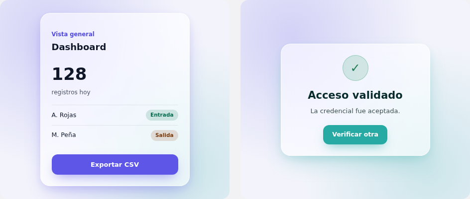

# Sistema de diseño

> **Estado: borrador (issue #55).** Este documento describe lo que el código de
> `mi-app-qr/client` y `verifier-web/` ya decidió, extraído directamente de
> `tailwind.config.ts` y de las hojas de estilo — no inventa valores nuevos. La sección
> "Divergencias a decidir en conjunto" reúne los puntos que sí son una decisión de
> producto pendiente. Ninguna de esas divergencias se cierra con este documento: se
> cierra cuando Jhunier y Duverney la acuerden explícitamente, igual que un ADR
> (ver `docs/DECISIONS.md`). Hasta entonces, este archivo documenta el estado actual,
> no un estándar ya aprobado.

**Corte verificable:** código integrado en `main`, commit
[`1b4498af0d2a76ceeadce0a114c40d9d758c7aab`](https://github.com/rlases/SecureQR-ID/tree/1b4498af0d2a76ceeadce0a114c40d9d758c7aab),
revisado el 24-10-2026 (hora de Colombia). Las pantallas propuestas en #102–#108
todavía no forman parte de este inventario de `main`; revisarlas al integrar esos PR.
Este cambio actualiza documentación y conserva las propuestas sin aplicarlas a la UI.

### Fuentes para reproducir el inventario

| Dato | Fuente del repositorio |
|---|---|
| Dependencias de cada app | [cliente](../mi-app-qr/client/package.json), [verificador](../verifier-web/package.json) |
| Tokens, radios y estilos globales del cliente | [index.css](../mi-app-qr/client/src/index.css), [tailwind.config.ts](../mi-app-qr/client/tailwind.config.ts) |
| Botón e input del cliente | [button.tsx](../mi-app-qr/client/src/components/ui/button.tsx), [input.tsx](../mi-app-qr/client/src/components/ui/input.tsx) |
| Jerarquía, estados y tablas | [DashboardPage](../mi-app-qr/client/src/pages/DashboardPage.tsx), [InformesPage](../mi-app-qr/client/src/pages/InformesPage.tsx), [LoginPage](../mi-app-qr/client/src/pages/LoginPage.tsx) |
| Layout e iconos del cliente | [App](../mi-app-qr/client/src/App.tsx), [Sidebar](../mi-app-qr/client/src/components/Sidebar.tsx) |
| Modal de salida olvidada activo | [RegistrosPage](../mi-app-qr/client/src/pages/RegistrosPage.tsx), [ForgottenOutModal](../mi-app-qr/client/src/components/ForgottenOutModal.tsx) |
| Paleta, tipografía, sombras, movimiento y breakpoints del verificador | [index.css](../verifier-web/src/index.css) |
| Iconos y resultado del verificador | [App](../verifier-web/src/App.tsx), [ScannerPanel](../verifier-web/src/components/ScannerPanel.tsx), [ResultPanel](../verifier-web/src/components/ResultPanel.tsx), [SessionHistory](../verifier-web/src/components/SessionHistory.tsx) |

Los valores de tablas inferiores son observaciones de esas fuentes. Los equivalentes
en píxeles de `rem` suponen la raíz habitual de 16px; el navegador puede ajustarla.

## Alcance y estado actual: dos lenguajes visuales, no uno

`mi-app-qr/client` y `verifier-web/` **no comparten un sistema de tokens hoy**. Es un
hallazgo, no una suposición de partida:

- `mi-app-qr/client` usa Tailwind CSS + shadcn/ui, con la paleta como variables HSL en
  `src/index.css` y consumida vía `tailwind.config.ts`.
- `verifier-web/` **no usa Tailwind** (no tiene `tailwind.config.*` ni la dependencia en
  `package.json`). Su paleta vive en CSS plano con variables personalizadas en
  `src/index.css`, con su propia escala tipográfica en píxeles y pesos numéricos no
  convencionales. **Sí usa React 18**, igual que el cliente: `react`, `react-dom` y
  los componentes TSX están presentes. CSS plano no significa ausencia de React.

Esto es consistente con ADR-0012, que exige que `verifier-web/` sea una aplicación
independiente que no importe código ni infraestructura de `mi-app-qr/`. Pero
"independiente en código" no obligaba a "independiente en paleta" — eso sí es una
decisión de producto que nunca se tomó explícitamente. Se documenta aquí el estado real
de cada app por separado; si deben converger a una sola paleta institucional es la
primera pregunta de la sección de divergencias, al final.

---

## `mi-app-qr/client`

### Color

Variables HSL definidas en `src/index.css` y consumidas por Tailwind vía
`hsl(var(--x))` (`tailwind.config.ts`). El hex es el equivalente calculado, para
referencia visual — la fuente de verdad es el triple HSL.

| Token | HSL | Hex | Uso |
|---|---|---|---|
| `--background` | `0 0% 100%` | `#ffffff` | Fondo de página |
| `--foreground` | `222 47% 11%` | `#0f1729` | Texto principal |
| `--primary` / `--ring` | `243 75% 59%` | `#5048e5` | Índigo aprobado (STATE.md): acciones primarias, foco, eyebrow labels |
| `--primary-foreground` | `0 0% 100%` | `#ffffff` | Texto sobre `--primary` |
| `--secondary` / `--muted` / `--accent` | `220 14% 96%` | `#f3f4f6` | Fondos secundarios, hover, chips neutros |
| `--secondary-foreground` / `--accent-foreground` | `222 47% 11%` | `#0f1729` | Texto sobre fondos secundarios |
| `--muted-foreground` | `215 16% 47%` | `#65758b` | Texto secundario/deshabilitado |
| `--border` / `--input` | `220 13% 91%` | `#e5e7eb` | Bordes, contornos de input |
| `--destructive` | `0 72% 51%` | `#dc2828` | Errores, acciones destructivas |
| `--destructive-foreground` | `0 0% 100%` | `#ffffff` | Texto sobre `--destructive` |
| `--success` / `--success-muted` | `163 94% 24%` / `149 80% 90%` | `#047857` / `#d1fae5` | Éxito: texto `-700` sobre fondo `-100` (4,9:1) |
| `--warning` / `--warning-muted` | `26 90% 37%` / `48 96% 89%` | `#b45309` / `#fef3c7` | Advertencia: texto `-700` sobre fondo `-100` (4,5:1) |
| `--success-foreground` / `--warning-foreground` | `0 0% 100%` | `#ffffff` | Texto sobre el tono `-700` sólido |
| `--radius` | — | `0.5rem` | Radio de borde base (botones, cards, inputs) |

**`--success` y `--warning` son tokens desde #129**, igual que `--destructive`. Antes
eran clases sueltas (`emerald-100/700`, `amber-100/700`); ahora se usan así:

```
success: 'bg-success-muted text-success'   (DashboardPage.tsx)
warning: 'bg-warning-muted text-warning'
neutral: 'bg-slate-100 text-slate-700'
```

La pareja de éxito marca el badge "Entrada" y la de advertencia, "Salida"
(`DashboardPage.tsx`, `InformesPage.tsx`); la de éxito también el "Vigente" del
historial de correcciones. `test/tokensEstado.test.ts` falla si vuelve a aparecer una
clase `emerald`/`amber` suelta.
"Entrada" y "Salida" son movimientos de asistencia: no equivalen a las decisiones
criptográficas "aceptada" y "rechazada" del verificador.

`ForgottenOutModal.tsx` **está activo**: `RegistrosPage.tsx` lo importa y lo monta al
detectar una posible salida olvidada. Su versión actual utiliza `bg-background`,
`border-border`, `text-muted-foreground`, `text-destructive` y el componente `Button`;
ya no contiene la paleta suelta teal/amarillo/naranja que describía el inventario
anterior.

### Radios, botones y foco

| Elemento | Definición observada | Equivalente habitual |
|---|---|---|
| `rounded-lg` | `var(--radius)` | 8px |
| `rounded-md` | `calc(var(--radius) - 2px)` | 6px |
| `rounded-sm` | `calc(var(--radius) - 4px)` | 4px |
| Botón normal / pequeño / grande | `h-10` / `h-9` / `h-11` | 40 / 36 / 44px de alto |
| Botón de solo icono | `h-10 w-10` | 40 × 40px |
| Input | `h-10`, `px-3 py-2` | 40px de alto; padding horizontal 12px |
| Foco de Button/Input | `focus-visible:ring-2`, `ring-ring`, `ring-offset-2` | Anillo de 2px, color de `--ring`, separación de 2px |

`Button` dispone de variantes `default`, `destructive`, `outline`, `secondary`,
`ghost` y `link`. Su clase base incluye `transition-colors`; el estado deshabilitado
reduce la opacidad al 50 %. Estos valores describen el componente actual, sin
afirmar que todos los controles particulares lo utilicen.

### Tipografía

Familia declarada en `tailwind.config.ts`: `fontFamily.sans = ['Inter', 'sans-serif']`,
aplicada globalmente vía `body { @apply font-sans }`. No hay `@font-face`, importación
de fuente ni `<link>` de carga en el código fuente/HTML revisados, ni archivos
woff/ttf/otf bajo estas apps. Declarar Inter no garantiza que esté disponible en el
equipo: el navegador puede usar el fallback. Su distribución queda pendiente de acuerdo.

Escala real en uso, tomada de componentes existentes (`Sidebar`, `DashboardPage`,
`InformesPage`, `LoginPage`, `HistorialCorreccionesModal`):

| Nivel | Clase | Tamaño / interlínea habitual | Uso |
|---|---|---|---|
| Métrica destacada | `text-3xl font-semibold` | 30 / 36px | Números grandes de Dashboard |
| Título de página | `text-2xl font-semibold` | 24 / 32px | "Dashboard", "Informes" |
| Título de componente | `text-lg` / `text-xl`, `font-semibold` | 18 / 28px o 20 / 28px | Marca, card de login, modal de historial |
| Subtítulo de sección | `font-semibold` | Tamaño heredado | "Actividad reciente", "Filtros", "Resultados" |
| Eyebrow | `text-sm font-medium text-primary` | 14 / 20px | "Vista general", "Consulta y extracción" |
| Cuerpo / tabla / botones | `text-sm` | 14 / 20px | Celdas, labels, botones |
| Caption / metadato | `text-xs` | 12 / 16px | Etiquetas `dt` en historial |
| Input | `text-base md:text-sm` | 16 / 24px; desde `md`, 14 / 20px | Campo compartido |

Pesos presentes: normal heredado (habitualmente 400), `font-medium` (500),
`font-semibold` (600) y **`font-bold` (700)** en el título de `ForgottenOutModal`.
Los títulos HTML no definen por sí solos una escala visual común h1–h6: las clases
mandan, y no hay tokens de heading h4–h6 documentados en estas pantallas.
El texto de carga/vacío alterna `text-sm` y el tamaño heredado; no se normaliza aquí.

### Espaciado

Escala de 4px de Tailwind por defecto, sin extensión personalizada en
`tailwind.config.ts`. Convenciones reales en uso:

| Contexto | Valor | Equivalente |
|---|---|---|
| Padding de card/panel (escritorio) | `p-6` | 24px |
| Padding de card/panel (cuerpo de sección) | `p-5` | 20px |
| Padding de card/panel (móvil) | `p-4` | 16px |
| Ritmo vertical entre secciones de página | `space-y-8` | 32px |
| Agrupación label + input | `space-y-2` | 8px |
| Gap en clusters de header/nav | `gap-3` | 12px |
| Gap en grillas de métricas / filas de formulario | `gap-4` | 16px |
| Gap en íconos de nav / icono+label de botón | `gap-1` / `gap-2` | 4px / 8px |
| Padding de celda de tabla | `px-5 py-3` (o `py-2` según la tabla) | — |

El contenedor principal usa `p-4 sm:p-6 lg:p-8`: 16/24/32px. La navegación pasa de
franja superior a lateral en `lg`; `sm` y `lg` no se redefinen en el config y conservan
los umbrales de Tailwind 3 (640 y 1024px). `md` comienza en 768px. Las tablas de
Dashboard/Informes tienen anchos mínimos y contenedores de scroll horizontal.

### Iconografía

Librería: **lucide-react**, usada en `Sidebar`, `RegistrosPage`, `DashboardPage`,
`InformesPage`, `HistorialCorreccionesModal`.

| Tamaño | Clase | Uso |
|---|---|---|
| Ícono estándar (nav, tabla, botón) | `size-4` | El más frecuente |
| Ícono de énfasis | `size-5` | Encabezados de sección, marca en sidebar |
| Ícono inline pequeño | `size-3` / `size-3.5` | Metadatos, badges |
| Contenedor de ícono tipo avatar | `size-9` / `size-10` | Insignia de marca en sidebar |

El componente `Button` de shadcn/ui incluye `[&_svg]:size-4`: sus SVG reciben 16px
por CSS de base. Una prop de tamaño por sí sola no elimina esa regla; comprobar la
cascada si un botón necesita una excepción.

**Convención documentada:** ocultar el icono decorativo al árbol accesible con
`aria-hidden="true"` (en el SVG o un contenedor). Un botón de solo icono debe tener
nombre accesible, por ejemplo `aria-label` en el botón; su SVG también puede ser
decorativo y estar oculto. Los ejemplos de Sidebar y Dashboard usan esta convención.
El inventario no acredita una auditoría de todos los controles.

---

## `verifier-web/`

### Color

Variables CSS en `src/index.css`. Paleta **teal/coral/verde/ámbar**, actualmente
distinta de la de `mi-app-qr/client`; no consta aquí un acuerdo de mantener la diferencia:

| Token | Hex | Uso |
|---|---|---|
| `--canvas` | `#edf3f2` | Fondo de página |
| `--surface` | `#ffffff` | Fondo de tarjetas |
| `--surface-soft` | `#f5f8f7` | Fondo secundario |
| `--ink` | `#142a29` | Texto principal |
| `--muted` / `--muted-strong` | `#5c706f` / `#415856` | Texto secundario |
| `--line` / `--line-strong` | `#d5e0de` / `#bdcdca` | Bordes |
| `--teal-500` | `#16a39c` | Acento principal (botones, indicador en vivo) |
| `--teal-700` / `--teal-800` | `#0d6d69` / `#0b5755` | Hover, gradientes |
| `--teal-950` | `#082c2b` | Encabezados, superficies oscuras |
| `--teal-100` | `#d9f1ee` | Fondo de acento suave |
| `--green-100` | `#dff3e7` | Fondo de estado aceptado |
| `--green-500` / `--green-700` / `--green-900` | `#2b9d6a` / `#18734c` / `#0f4a31` | Estado "aceptado" |
| `--coral-100` | `#fbe6e4` | Fondo de estado rechazado |
| `--coral-500` / `--coral-700` / `--coral-900` | `#db5953` / `#b63e39` / `#7a2521` | Estado "rechazado" |
| `--amber-100` | `#f7ebcf` | Fondo de estado no disponible |
| `--amber-700` | `#9a6515` | Estado "servicio no disponible" |
| `--focus` | `#0f827d` | Anillo de foco (`rgba(15,130,125,0.28)`) |

`--focus` está declarado, pero la regla de foco de `button/input/select` escribe
directamente `outline: 3px solid rgba(15,130,125,0.28); outline-offset: 2px`.
Cambiar solo la variable no cambiaría ese contorno. La paleta tampoco cubre todos
los literales de CSS: hay bordes y gradientes con colores escritos directamente.

### Tipografía

`font-family: Inter, ui-sans-serif, system-ui, -apple-system, BlinkMacSystemFont,
"Segoe UI", sans-serif` — declarada como pila CSS, no como config de Tailwind (esta app
no usa Tailwind). Mismo Inter como familia principal que `mi-app-qr/client`, con una
cadena de reemplazo de sistema más larga.
Al igual que en el cliente, no se encontró un mecanismo de carga de Inter en el
código/HTML revisados. Los pesos declarados pueden resolverse mediante una fuente
de reemplazo; no implican que esté cargada una variante variable de Inter.

| Nivel | Tamaño / peso | Uso |
|---|---|---|
| Hero (decisión grande) | `46px` / peso `800` | Título grande de resultado dentro del layout |
| `h1` | `24px` / peso `760` | Título de página |
| `h2` (result card) | `18–22px` / peso `740` | Título de superficie |
| Cuerpo (result card) | `14px` | Texto de descripción de resultado |
| Eyebrow | `11px`, mayúsculas, peso `780` | Etiquetas sobre título |
| Botones | `13px` | — |

Usa **pesos numéricos no convencionales** (`680`, `720`, `740`, `760`, `780`, `800`) en
vez de los pasos estándar 400/500/600/700 que usa `mi-app-qr/client` vía
`font-medium`/`font-semibold`. Divergencia real, no solo de valores sino del propio
sistema de pesos — ver divergencias.

### Espaciado

Sin Tailwind: valores en píxeles escritos a mano, alineados de forma laxa a múltiplos
de 4px pero sin una escala formal. Ejemplos: header `padding: 12px 24px`, `gap: 24px`;
superficie de escáner `padding: 24px`; cuerpo de formulario manual `padding: 40px`;
`.field-group` `gap: 7px` (valor fuera de escala); botones `padding: 9px 16px`. Se
reduce en los breakpoints responsivos (`18px`, `15px`, `14px`, `10px`).

### Iconografía

También **lucide-react** (`package.json`: `^0.427.0`), usado en `App.tsx`,
`ResultPanel.tsx`, `SessionHistory.tsx`. Como no hay Tailwind, el tamaño se pasa como
prop numérica en píxeles, no como clase:

| Tamaño | Uso |
|---|---|
| `size={16}` | Estado de servicio, historial de sesión |
| `size={17}` / `size={18}` | Botón de refrescar / siguiente |
| `size={25}` | Marca |
| `size={42}` / `size={72}` | Ilustraciones de estado grandes en el panel de resultado |

Misma convención de `aria-hidden="true"` en íconos decorativos junto a texto, aplicada
en varios componentes o sus contenedores. El hero de `ResultPanel` también tiene
SVG sin esa marca; no se presenta el cumplimiento como universal. En el código
revisado el icono grande del hero usa `size={72}`; el inventario anterior de 96px no
corresponde a ese componente.

### Radios, sombras, movimiento y adaptación existentes

| Elemento / regla | Valor observado |
|---|---|
| Radio base | `--radius: 8px` |
| Sombra suave | `--shadow-soft: 0 10px 30px rgba(17, 51, 49, 0.08)` |
| Sombra elevada declarada | `--shadow-raised: 0 20px 45px rgba(8, 44, 43, 0.13)` |
| Header traslúcido | Fondo `rgba(255,255,255,0.72)`, `backdrop-filter: blur(14px) saturate(160%)`, radio 16px |
| Sombra del header | `0 1px 0 rgba(255,255,255,0.8) inset, 0 14px 32px rgba(15,49,47,0.09)` |
| Panel de resultado | Transiciones de fondo, sombra y borde de 180ms |
| Barrido de cámara | `scan-beam 2.2s ease-in-out infinite` |
| Indicador en vivo | `live-dot 1.4s ease-out infinite` |
| Entrada de estado / historial | `status-enter` (220/240ms), `history-enter` (180ms) |
| Movimiento reducido | `prefers-reduced-motion: reduce`: duración 0.001ms, una iteración y scroll automático |
| Breakpoints | `max-width: 1040px`, `820px`, `600px` |

Las superficies scanner/result/history consumen `--shadow-soft`; la declaración
`--shadow-raised` no garantiza por sí sola su uso. El CSS contiene más sombras y
animaciones locales; esta tabla recoge ejemplos verificables, sin convertirlos en
un sistema compartido. La regla de movimiento reducido existe en el verificador;
no se encontró una regla global equivalente en `mi-app-qr/client/src/index.css`.

---

## Modo oscuro

**Fuera del piloto, por acuerdo (#55).** No está implementado en ninguna de las dos
apps. El `darkMode: ['class']` inerte que traía `tailwind.config.ts` de
`mi-app-qr/client` (andamiaje de shadcn/ui que nunca se activó) se retiró en #129 para
no sugerir una capacidad que no existe. Queda como pendiente para después del piloto.

---

## Sombra y movimiento (propuesta de Jhunier, pendiente de acuerdo)

El cliente ya usa sombras utilitarias (`shadow-sm` en cards y `shadow-xl` en el modal)
y transiciones de color en botones y navegación. El verificador ya tiene vidrio en
el header, sombras y animaciones CSS, como detalla su inventario. Lo pendiente es
acordar un lenguaje común y su alcance, no añadir efectos sobre una base sin ellos.

Se conserva la propuesta previa de Jhunier, **"Vidrio elevado"**, pendiente de
acuerdo: paneles traslúcidos (`backdrop-filter: blur`) apoyados por una sombra grande
y coloreada con el acento de cada app, para que el panel se sienta elevado y no solo
transparente. Se eligió sobre otras tres direcciones exploradas (sombra plana coloreada
sin cristal, cristal sobre fondo oscuro, y un tratamiento minimalista casi sin sombra)
porque combina el efecto "producto cuidado" del cristal con la legibilidad de un fondo
mayormente claro — relevante para pantallas institucionales usadas con luz de día.



**Especificación técnica de la propuesta:**

| Propiedad | Valor | Nota |
|---|---|---|
| Fondo del panel | `rgba(255,255,255,0.60)` sobre un lienzo con degradado suave del acento de la app | El degradado de fondo usa el color primario de cada app al ~18-20% de opacidad |
| `backdrop-filter` | `blur(22px) saturate(140%)` | Requiere `-webkit-backdrop-filter` para Safari |
| Borde | `1px solid rgba(255,255,255,0.75)` | Simula el borde de un vidrio esmerilado |
| Sombra en reposo | `0 20px 45px -14px <acento al 32%>, 0 6px 16px <acento al 10%>` | Color de sombra = `--primary` en `mi-app-qr/client` (`#5048e5`), `--teal-500` en `verifier-web` (`#16a39c`) |
| Sombra en hover | Misma fórmula, opacidades subidas a 40%/14% | Junto con `transform: translateY(-6px)` |
| Transición | `transform .35s cubic-bezier(.2,.8,.2,1), box-shadow .35s, background .35s` | — |

**Nueva dependencia propuesta:** GSAP para las
animaciones de entrada (fade + stagger) y el conteo numérico en métricas tipo
Dashboard. **No está instalada en los `package.json` revisados.** Las dos apps usan
React; por tanto, la explicación anterior basada en que el verificador no usaba
React era incorrecta y no justifica elegir GSAP frente a otra solución. La elección
de biblioteca y su coste real de bundle requieren evaluación y acuerdo separados;
no se fija aquí un tamaño sin medirlo. Los efectos CSS existentes no requieren GSAP.

**Esto es una propuesta, no un estándar cerrado.** Sigue el mismo patrón que el resto
de este documento: se discute con Duverney y solo entonces se implementa. Ver punto 5
de "Divergencias identificadas" abajo.

---

## Divergencias identificadas (a decidir en conjunto)

Estos puntos son decisiones de producto, no hechos del código — no se cierran con este
documento. Quedan explícitamente para acordar con Duverney antes de cerrar el issue #55:

1. **¿Un solo sistema de tokens o dos lenguajes visuales mantenidos a propósito?**
   Hoy son dos paletas distintas (índigo/shadcn vs. teal/coral). ADR-0012 exige
   independencia de código, no necesariamente de paleta. Definir si se unifica una
   paleta institucional compartida o si la separación visual queda como decisión
   consciente (por ejemplo, para que el personal distinga a simple vista en cuál de
   las dos herramientas está).
2. **Tokenizar éxito/advertencia en `mi-app-qr/client`.** Hoy son clases sueltas
   (`emerald-100/700`, `amber-100/700`), no variables `--success`/`--warning` como las
   que sí existen para `--destructive`. Decidir si se agregan como tokens formales.
3. **Normalizar los pesos de fuente de `verifier-web/`.** Los valores numéricos no
   convencionales (`680`–`800`) no tienen equivalente directo en la escala
   `medium`/`semibold`/`bold` de `mi-app-qr/client`. Decidir si se migra a una escala
   estándar o se documenta como intencional.
4. **Modo oscuro.** Decidir si se implementa (y en qué app primero) o si se retira el
   `darkMode: ['class']` inerte de `tailwind.config.ts` para no sugerir una capacidad
   que no existe.
5. **La dirección "Vidrio elevado" y la dependencia de GSAP.** Jhunier ya eligió esta
   dirección entre cuatro exploradas (ver sección anterior) pero falta el acuerdo de
   Duverney antes de implementarla en cualquiera de las dos apps — incluye agregar una
   librería nueva (`gsap`) a ambos `package.json`, no solo un cambio de CSS.
6. **Disponibilidad de la fuente.** Acordar si Inter se distribuye localmente o si
   se documentan las fuentes de sistema como apariencia efectiva. Declararla en CSS
   sin cargarla no fija el resultado entre equipos. La decisión debe contemplar la
   operación en LAN y no añadir una petición a un proveedor externo por defecto.

### Registro de acuerdo para cerrar #55

La siguiente tabla deja el resultado por escrito; ninguna fila se completa por
inferencia ni mediante la aprobación rutinaria de otro PR:

| Decisión | Estado | Constancia de Jhunier y Duverney |
|---|---|---|
| Paleta compartida o diferenciada y valores | Acordada: acentos distintos (índigo `#5048e5` en el cliente, teal en `verifier-web/`) con tokens de éxito, advertencia y error comunes. Criterio de contraste: los tonos `-500` solo en elementos de interfaz (≥ 3:1); el texto sobre color usa `-700` o más oscuro (≥ 4,5:1). `.primary-button` parte de `--teal-700` | [propuesta de Duverney](https://github.com/rlases/SecureQR-ID/pull/114#pullrequestreview-5640742482); [confirmación de Jhunier](https://github.com/rlases/SecureQR-ID/pull/114#issuecomment-6392185680) |
| Tokens de éxito/advertencia del cliente | Acordada: formalizar `--success` y `--warning` como `--destructive` | [propuesta de Duverney](https://github.com/rlases/SecureQR-ID/pull/114#pullrequestreview-5640742482); [confirmación de Jhunier](https://github.com/rlases/SecureQR-ID/pull/114#issuecomment-6392185680) |
| Familia disponible y escala/pesos tipográficos | Acordada: fuentes del sistema o Inter local, nunca de un proveedor externo; pesos de `verifier-web/` normalizados a `medium/semibold/bold` | [propuesta de Duverney](https://github.com/rlases/SecureQR-ID/pull/114#pullrequestreview-5640742482); [confirmación de Jhunier](https://github.com/rlases/SecureQR-ID/pull/114#issuecomment-6392185680) |
| Modo oscuro y alcance | Acordada: fuera del piloto; se retira `darkMode: ['class']` y queda como pendiente | [propuesta de Duverney](https://github.com/rlases/SecureQR-ID/pull/114#pullrequestreview-5640742482); [confirmación de Jhunier](https://github.com/rlases/SecureQR-ID/pull/114#issuecomment-6392185680) |
| Vidrio, sombras, movimiento y dependencia | Acordada: «Vidrio elevado» solo con CSS; GSAP rechazado por ahora | [propuesta de Duverney](https://github.com/rlases/SecureQR-ID/pull/114#pullrequestreview-5640742482); [confirmación de Jhunier](https://github.com/rlases/SecureQR-ID/pull/114#issuecomment-6392185680) |

Para cada fila se debe registrar el resultado y el enlace a la discusión explícita
de ambos autores. Este inventario de código permite revisar valores concretos sin
dar las propuestas por implementadas. Al acordarlos, actualizar el documento y
conservar la distinción entre estándar aprobado y adopción pendiente en cada app.

## Aprobación

Abierto por Jhunier. Duverney revisó explícitamente el contenido completo y propuso
cada fila; Jhunier las confirmó (enlaces en la tabla de arriba). Con eso se cierra el
acuerdo de #55. La adopción en cada app va en PR aparte: tokens de estado y retirar
`darkMode` en `mi-app-qr/client` (#129); contraste de `.primary-button` y pesos
tipográficos en `verifier-web/` (#130).
